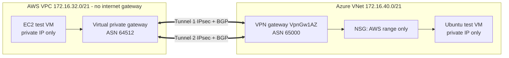

# AWS ↔ Azure Hybrid Network: Private, Encrypted, BGP-Routed

[](https://github.com/Monkmode-tech/aws-azure-hybrid-network/actions/workflows/ci.yml)


**Roles this project supports:** Cloud Architect · Cloud Engineer · Cloud Network Engineer · Solutions Architect

## In plain terms (2-minute read)

**The problem.** Many companies use both Amazon Web Services and Microsoft
Azure, often after a merger or because different teams chose different clouds.
Their systems need to talk to each other **privately and securely**, not over
the open internet, and the connection must keep working if one piece fails.

**What I built.** A private, encrypted link between an AWS network and an
Azure network, written entirely as code:

- **Encrypted tunnels** connect the two clouds. Everything crossing between
  them is scrambled with bank-grade encryption.
- **Two tunnels, not one.** If one path fails, traffic automatically moves to
  the other, like a second road when one is closed.
- **The networks find each other automatically.** The clouds tell each other
  which addresses they own (BGP, the protocol the internet itself uses), so
  nobody has to maintain routing tables by hand.
- **Nothing is exposed to the internet.** The test servers on both sides have
  no public addresses at all, and the AWS network doesn't even have an internet
  connection. The only way in is the private tunnel, and only for specific,
  approved traffic.
- **The address plan comes from my coursework.** I designed it for a
  four-office company in my networking course (CLCS 635), and it leaves room for an
  on-premises office and future growth.

**Proof, not promises.** A validation script checks 11 things on the live
system, including sending real traffic both ways and capturing packets on the
Azure server to show they arrived from AWS's *private* addresses, which proves
they never touched the public internet.

**Why it matters to a business**

| Business need | How this project delivers it |
|---------------|------------------------------|
| Connect systems across two cloud providers | Site-to-site IPsec VPN between AWS and Azure |
| Keep data private in transit | All traffic encrypted (AES-256); servers have no public addresses |
| Stay connected when something fails | Two active tunnels with automatic failover; tested with a script |
| Avoid manual network maintenance | Routes exchanged automatically with BGP |
| Reduce attack surface | No internet-facing servers or admin ports; access limited to specific ports from the other cloud |
| Plan for growth | Address plan reserves space for an on-premises office and a fourth site |
| Control cost | About $1 per test session; everything is torn down after use |

**What this shows about how I work.** I can design across vendors, not just
within one, and I verify my work with evidence instead of assuming it works.

## Technical summary

Terraform deploys both clouds from one root module:

- **AWS (us-east-2):** VPC `172.16.32.0/21` with **no IGW and no NAT**; virtual private gateway (ASN 64512) with BGP route propagation; SSM interface endpoints for private administration; KMS-encrypted VPC flow logs; Graviton test VM with IMDSv2 and an encrypted root volume
- **Azure (East US):** VNet `172.16.40.0/21`; zone-redundant **VpnGw1AZ** route-based gateway (ASN 65000) with **custom APIPA BGP addresses**; NSG that admits only the AWS range and explicitly overrides `AllowVnetInBound`; Ubuntu test VM with SSH-key-only auth and no public IP
- **VPN:** one AWS Site-to-Site VPN connection = **two IKEv2 tunnels, both BGP-peered**; crypto pinned on both ends (AES-256 / SHA-256 / DH14 / PFS14); 40-character generated pre-shared keys; CloudWatch alarm on tunnel state
- **Verification:** `validate-connectivity.sh` (tunnels, BGP peers, learned routes on both sides, bidirectional traffic, exposure checks, tcpdump proof of private source IPs) and `failover-test.sh`

> Compared with a typical first multicloud lab (two public VMs and SSH
> allow-lists, VPN listed as future work), this implements the VPN, BGP,
> private-only subnets and keyless administration end to end.

## Architecture



Details: [architecture](docs/architecture.md) · [IP plan](docs/ip-plan.md) · [runbook](docs/runbook.md) · [cost](docs/cost.md) · [ADRs](docs/adr)

## Results

> From a live deployment; raw reports in [`docs/evidence`](docs/evidence).

| Check | Result |
|-------|--------|
| Connectivity validation (11 checks) | _pending first deployment_ |
| Packets lost during tunnel-1 failover | _pending_ |
| BGP routes learned (AWS ← Azure, Azure ← AWS) | _pending_ |

## Quick start

```bash
az login
cd environments/lab
cp backend.hcl.example backend.hcl
cp terraform.tfvars.example terraform.tfvars   # Azure subscription id, SSH public key, email
terraform init -backend-config=backend.hcl
terraform apply                                # 45-60 min (Azure VPN gateway)
../../scripts/validate-connectivity.sh
terraform destroy                              # always, after the session
```

## Where to look

| Skill | Evidence |
|-------|----------|
| Multicloud network design and IP planning | [docs/ip-plan.md](docs/ip-plan.md) |
| Site-to-site VPN, IPsec/IKEv2 crypto alignment, BGP with APIPA | [`modules/aws-azure-vpn`](modules/aws-azure-vpn/main.tf), [ADR 0002](docs/adr/0002-bgp-over-static-routes.md) |
| Azure networking (VNet, GatewaySubnet, NSG precedence, VPN gateway) | [`modules/azure-network`](modules/azure-network/main.tf) |
| AWS networking (VGW, route propagation, endpoints, flow logs) | [`modules/aws-network`](modules/aws-network/main.tf) |
| Zero-exposure administration | [ADR 0003](docs/adr/0003-no-public-ips-no-bastions.md) |
| Network verification and troubleshooting | [`scripts/`](scripts), [runbook troubleshooting](docs/runbook.md#troubleshooting) |
| Architecture trade-offs | [ADR 0001](docs/adr/0001-vgw-instead-of-transit-gateway.md), [roadmap](docs/architecture.md#whats-next-roadmap) |
| Cross-cloud identity | [docs/identity-federation.md](docs/identity-federation.md) |

## Certification alignment

| Exam | Areas exercised |
|------|-----------------|
| AWS Solutions Architect – Associate | Hybrid connectivity, VPC design, secure access, cost-optimized networking |
| Microsoft Azure Administrator (AZ-104) | Virtual networking: VNets, subnets, NSGs, VPN gateway, connectivity troubleshooting |
| HashiCorp Terraform Associate | Multiple providers in one configuration, modules, cross-resource dependencies |

## Glossary (for non-technical readers)

| Term | Meaning |
|------|---------|
| VPC / VNet | A private network inside AWS / Azure |
| VPN tunnel (IPsec) | An encrypted connection across the internet that behaves like a private cable |
| BGP | The protocol networks use to tell each other which addresses they can reach |
| Public IP | An address reachable from the internet; these servers deliberately have none |
| NSG / security group | Firewall rules attached to Azure / AWS resources |
| CIDR, e.g. 172.16.32.0/21 | A block of network addresses; /21 = 2,048 addresses |
| Failover | Automatically switching to a backup path when the main one fails |

## Background

Built by **Caleb Tetteh** (M.S. Cloud Computing Systems, UMGC; B.S. Computer
Science, Georgia Tech). It brings together CLCS 635 *Networking Engineering for
Cloud Computing* (subnet design, IGW/NAT/route tables, connectivity testing,
Wireshark analysis) and the hybrid AWS + Azure governance challenge from the
CLCS 625 capstone.
