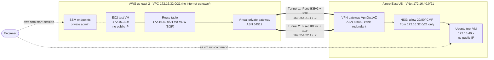

# Architecture

## How traffic flows

1. The EC2 VM sends a packet to `172.16.40.4`. The VPC route table has
   `172.16.40.0/21 → virtual private gateway`, learned from Azure over BGP,
   not typed in by hand.
2. AWS encrypts it (AES-256, SHA-256, DH group 14) into one of two IPsec tunnels
   to the Azure VPN gateway's public IP.
3. Azure decrypts it and delivers it into the VNet with the **original private
   source address** (`172.16.32.x`). There is no NAT, which the packet-capture
   check proves.
4. The workload NSG allows it only because the source is inside `172.16.32.0/21`
   and the port is 22, 80 or ICMP. Everything else is explicitly denied.

## Redundancy

- **Two tunnels, both active.** Each AWS VPN connection terminates on two
  separate AWS endpoints. Both tunnels are configured on Azure with their own
  BGP session. If one endpoint goes away (e.g., AWS maintenance), BGP withdraws
  that path and traffic continues on the other. `scripts/failover-test.sh`
  measures the impact.
- **Zone-redundant Azure gateway** (`VpnGw1AZ` with a zone-redundant public IP).
- **Monitoring:** a CloudWatch alarm fires if either tunnel is down for 10 minutes.

## Security model

| Concern | Control |
|---------|---------|
| Internet exposure | No public IPs on either VM; the AWS VPC has no internet gateway at all |
| Admin access | SSM Session Manager (AWS) and `az vm run-command` (Azure). No SSH ports open to anyone, no bastions to patch |
| Lateral movement from the other cloud | SG and NSG allow only the specific ports from the other cloud's CIDR |
| Azure's implicit trust of VPN prefixes | `deny-all-other-inbound` (priority 4000) overrides the default `AllowVnetInBound` rule |
| Data in transit | IPsec with a pinned AES-256 / SHA-256 / DH14 policy on both ends |
| Secrets | Pre-shared keys are generated by Terraform (40 random characters) and never typed or committed |
| Visibility | VPC flow logs (KMS-encrypted) record every flow across the tunnel |

## What's next (roadmap)

- **Active-active Azure gateway** with two public IPs and four tunnels (survives an Azure instance failure without renegotiation)
- **AWS Transit Gateway** instead of a VGW when more than one VPC needs to reach Azure (see ADR 0001)
- **Identity federation:** Microsoft Entra ID as the identity provider for AWS IAM Identity Center ([docs/identity-federation.md](identity-federation.md))
- **Azure VNet flow logs** and **Azure Monitor** alerts on tunnel bandwidth and BGP peer status
- A third site (`172.16.48.0/21`) for an on-premises network using the same module
